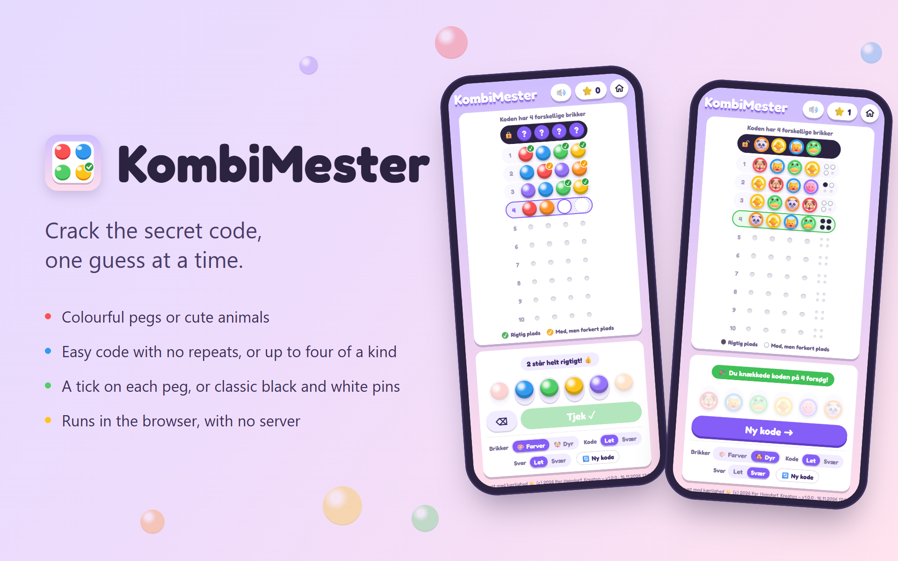

# KombiMester


[](LICENSE)



**A code-breaking game for children (about 5–10 years), in the spirit of the classic peg game Mastermind.**

▶️ **Play it:** <https://kreaton.github.io/KidsGames/kombimester/>

The game hides a code of four pegs. The child guesses, gets told how close the guess was, and cracks the code in at most ten tries. It is a Blazor WebAssembly app (.NET 10) that runs entirely in the browser, with no server or backend. The game itself is in Danish.

## How to play

Tap the pegs at the bottom to fill the row, then press **Tjek ✓**. Tapping a peg already in the row takes it back out, and **⌫** removes the last one. The row on the board shows where the next peg goes.

When the code is cracked, the lid opens, a star is added, and every fifth star gives a trophy and confetti. After ten wrong guesses the code is shown, and **Ny kode ➜** starts a new one.

Each guess also gets a short message, such as "1 står rigtigt, og 2 skal flyttes!", so a child who cannot read the marks yet still gets help.

## Settings

Three switches at the bottom of the panel. They are remembered in the browser.

| | Let (easy) | Svær (hard) |
|---|---|---|
| **Brikker** (pegs) | 🎨 Six colours | 🐶 Six animals: dog, cat, frog, chick, pig and panda |
| **Kode** (code) | Every peg in the code is different. A peg already in the row can't be picked again. | The same peg can be in the code up to four times. |
| **Svar** (marks) | A tick on each peg: green ✓ for the right place, amber ✓ for "in the code, but somewhere else" | Classic pins beside the row: one black per peg in the right place, one white per peg that is somewhere else, without saying which |

*Brikker* is not a difficulty, just the look; the animals sit on a pale version of the matching colour. Changing the looks or the marks keeps the game going (the board is redrawn in the new style); changing the code rule starts a new code.

With repeats, a peg is only marked as many times as it is in the code: if the code has one red and the guess has two, only one of them gets a mark.

## Keyboard

`1`–`6` place a peg, `Backspace` removes one, `←` `→` pick a slot, and `Enter` checks (or starts the next code).

## Project layout

```
KombiMester.slnx
src/KombiMester/
  Game/CodeGame.cs          The hidden code, the rules for a guess and the marks
  Pages/Home.razor          The board, the pegs to pick from and the settings
  wwwroot/
    index.html              Host page, <base href>
    css/app.css             All styling and animations
    js/kombi.js             Keyboard play and the saved settings
    js/sounds.js            Peg pops, mark pings, fanfares and try-again sounds (Web Audio API, no audio files)
    manifest.webmanifest
    icons/                  App icons and favicon
tools/make-icons.ps1        Draws the icons
```

## Running locally

Requires the [.NET 10 SDK](https://dotnet.microsoft.com/download).

```bash
dotnet run --project src/KombiMester
```

Then open http://localhost:5327.

Stop the app before building it again. A running dev server keeps the list of files it started with, and after a rebuild the page can hang on "Indlæser".

## Publishing

Pushing to `main` builds the app and puts it in the `kombimester/` folder of the KidsGames GitHub Pages site (<https://kreaton.github.io/KidsGames/kombimester/>) with [`.github/workflows/deploy.yml`](.github/workflows/deploy.yml). It needs the repository secret `PAGES_DEPLOY_KEY`: the private half of a deploy key with write access to `kreaton/KidsGames`.

The app is served from a `kombimester` sub-path: `<base href>` in [`wwwroot/index.html`](src/KombiMester/wwwroot/index.html) is `kombimester`.

The game is not on the KidsGames front page yet. To add it, put a card in `KidsGames/index.html` and run `tools/make-icons.ps1 -FrontPageDir ..\KidsGames\billeder` to copy the icon there.

## License

[MIT](LICENSE) © 2026 Per Hejndorf, Kreaton
